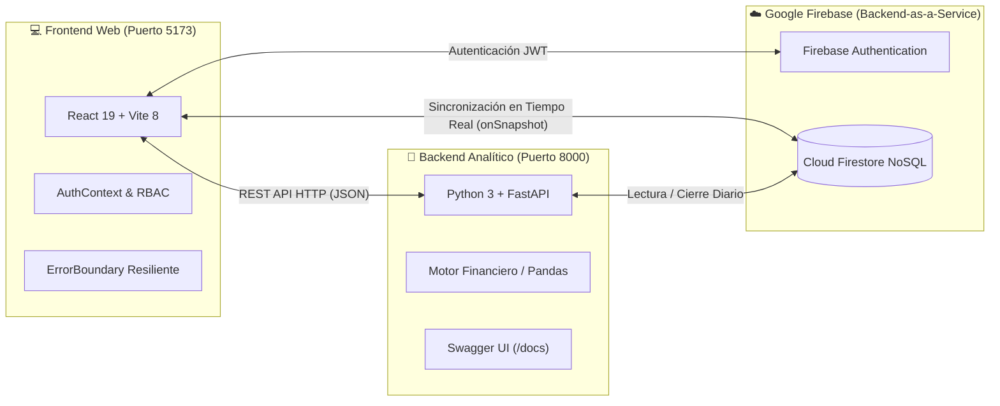
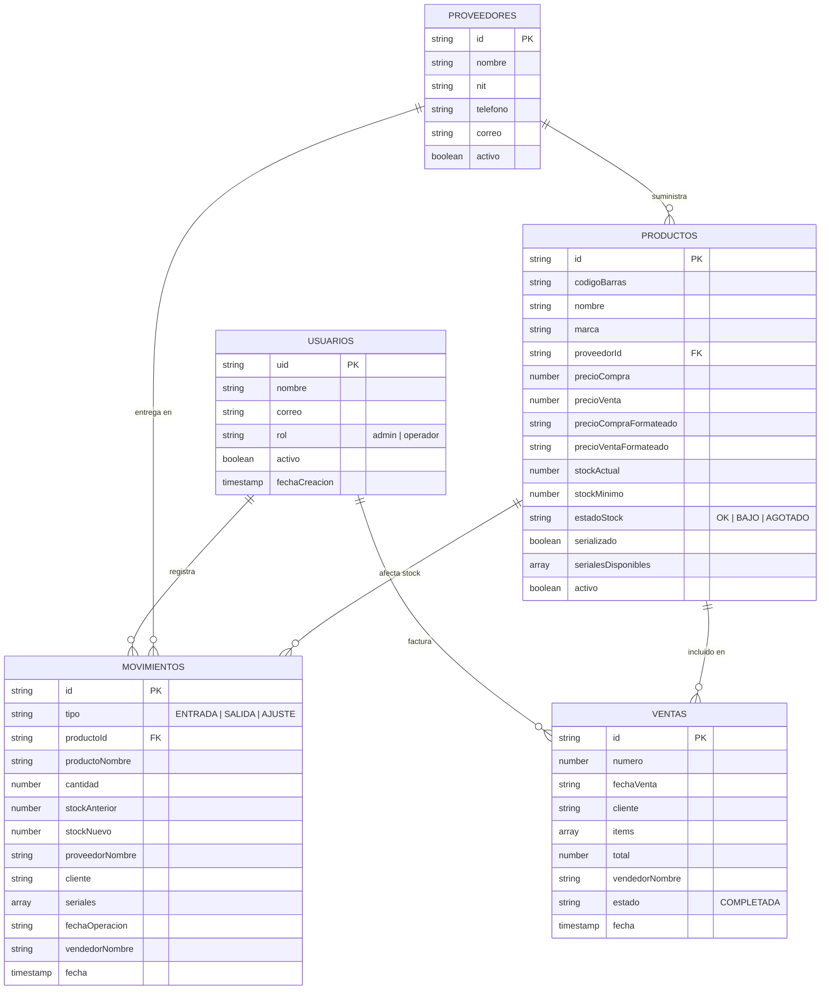

# 📱 Documento de Contexto del Proyecto: TecnoStock Web

> [!NOTE]
> **Nombre del Proyecto:** TecnoStock Web — Sistema de Gestión de Inventario y Ventas para Tiendas de Tecnología  
> **Repositorio Oficial:** [PulidoMiguelacademy/Gestion_de_inventario.](https://github.com/PulidoMiguelacademy/Gestion_de_inventario.)  
> **Arquitectura:** Aplicación Web Fullstack en Tiempo Real (React 19 + Python FastAPI + Google Firebase)

---

## 1. Introducción y Problemática del Negocio

En los pequeños y medianos comercios dedicados a la comercialización de productos tecnológicos (teléfonos celulares, computadores, repuestos y accesorios), el control de existencias suele llevarse en hojas de cálculo manuales o cuadernos físicos. Esta práctica genera cuatro problemas críticos:

1. **Desabastecimiento y pérdida de ventas:** No existen alertas automáticas cuando un artículo de alta rotación está próximo a agotarse.
2. **Descuadres de inventario:** Las ventas y las entradas de mercancía no se descuentan ni suman en tiempo real, provocando diferencias entre el stock físico en vitrina y el registrado.
3. **Falta de trazabilidad por serial / IMEI:** En dispositivos como celulares, resulta indispensable saber exactamente qué número de serie ingresó con qué proveedor y a qué cliente fue vendido para responder por garantías.
4. **Riesgo de seguridad operativa:** Todos los empleados suelen tener acceso a modificar precios o borrar registros sin una separación de permisos entre el propietario (Administrador) y los vendedores (Operadores).

**TecnoStock Web** nace como una plataforma centralizada, intuitiva y en tiempo real que digitaliza de principio a fin el flujo de inventario, recepción de proveedores, facturación con lector de código de barras y auditoría financiera.

---

## 2. Objetivos del Proyecto

### Objetivo General
Desarrollar un sistema web Fullstack para la gestión de inventario y control de ventas en tiempo real para una tienda de tecnología, garantizando la trazabilidad de existencias, el control de acceso basado en roles y la generación de reportes financieros.

### Objetivos Específicos
* **Controlar el acceso y la seguridad:** Implementar autenticación cifrada, recuperación de contraseña por correo y separación de roles (*Administrador* vs. *Operador*).
* **Centralizar el catálogo tecnológico:** Registrar, buscar, actualizar y clasificar productos con soporte de códigos de barras, precios en formato local (COP) y manejo de seriales/IMEIs.
* **Auditar las entradas y salidas (Kardex):** Registrar ingresos de mercancía asociados a proveedores y descontar automáticamente las unidades vendidas, almacenando el historial inmutable de cada movimiento.
* **Prevenir quiebres de stock:** Automatizar un semáforo de existencias (*OK*, *Bajo Stock* y *Agotado*) basado en umbrales mínimos configurables por producto.
* **Soportar la toma de decisiones financieras:** Integrar un microservicio en Python para calcular la valoración contable del inventario, el margen de ganancia proyectado y el cierre diario de caja.

---

## 3. Arquitectura Tecnológica (Stack Fullstack)

El proyecto implementa una arquitectura moderna desacoplada en tres capas principales:

| Capa | Tecnología | Propósito en el Proyecto |
| :--- | :--- | :--- |
| **Frontend** | React 19, Vite 8, CSS Moderno, Lucide Icons | Interfaz de usuario reactiva, rápida y adaptada al flujo de mostrador y bodega. |
| **Autenticación** | Firebase Authentication | Inicio de sesión seguro, persistencia de sesión y envío de enlaces de restablecimiento de clave. |
| **Base de Datos** | Cloud Firestore (NoSQL) | Almacenamiento en la nube con actualización instantánea sin necesidad de recargar la página. |
| **Backend API** | Python 3, FastAPI, Uvicorn, Pydantic | Procesamiento matemático de valoración de inventario, márgenes de utilidad y cierres diarios. |

---

## 4. Modelo de Base de Datos (Colecciones en Firestore)

La base de datos en **Cloud Firestore** (`tienda-tecnologia-inventario`) se estructura en las siguientes colecciones documentales:

---

## 5. Descripción de Módulos y Vistas del Sistema

### 🔐 5.1. Módulo de Acceso y Seguridad ([Login.jsx](file:///C:/Users/Admin/Documents/03_Cuarto/TecnoStock/TecnoStock_web/frontend/src/pages/Login.jsx) y [AuthContext.jsx](file:///C:/Users/Admin/Documents/03_Cuarto/TecnoStock/TecnoStock_web/frontend/src/context/AuthContext.jsx))
* **Inicio de sesión y Registro:** Permite autenticar usuarios existentes o registrar nuevos colaboradores (a quienes se les asigna por seguridad el rol de `operador` por defecto).
* **Recuperación de contraseña:** Envía un enlace oficial al correo electrónico del usuario para restablecer su clave.
* **Verificación de cuenta activa:** Si un administrador desactiva a un empleado, el sistema bloquea su acceso de forma inmediata.

### 📊 5.2. Panel General / Dashboard ([Dashboard.jsx](file:///C:/Users/Admin/Documents/03_Cuarto/TecnoStock/TecnoStock_web/frontend/src/pages/Dashboard.jsx))
* Muestra indicadores clave en tiempo real: **Productos Registrados**, **Unidades en Vitrina**, **Valoración Total a Costo** y **Alertas de Stock**.
* Incluye un **Banner de Atención Inmediata** que lista los artículos agotados o por debajo del stock mínimo.

### 📦 5.3. Catálogo de Productos ([Products.jsx](file:///C:/Users/Admin/Documents/03_Cuarto/TecnoStock/TecnoStock_web/frontend/src/pages/Products.jsx))
* Creación de productos permitiendo formato numérico con puntos de miles (`650.000`, `1.200.000`).
* Buscador en vivo por nombre o código de barras y filtro por estado (`OK`, `BAJO`, `AGOTADO`).
* **Edición y Eliminación protegida:** Solo los usuarios con rol `admin` visualizan y pueden ejecutar los botones de **Editar** y **Eliminar**.

### 🔄 5.4. Historial de Movimientos, Entradas y Ventas ([Movements.jsx](file:///C:/Users/Admin/Documents/03_Cuarto/TecnoStock/TecnoStock_web/frontend/src/pages/Movements.jsx))
* **Consultar Historial (Kardex):** Tabla auditable con filtros por fecha, producto, serial y tipo de operación (`ENTRADA`, `SALIDA`, `AJUSTE`), mostrando la transición exacta (*Stock Anterior ➔ Stock Nuevo*).
* **Registrar Entrada de Mercancía:** Formulario para recepcionar pedidos seleccionando producto, proveedor, fecha de ingreso, cantidad y escaneo de seriales/IMEIs, sumando automáticamente las unidades al stock actual.
* **Registrar Venta con Escáner:** Punto de venta que permite agregar uno o varios productos mediante lector de código de barras o selector, asignar los seriales entregados al cliente y descontar automáticamente las existencias.

### 🚚 5.5. Directorio de Proveedores ([Suppliers.jsx](file:///C:/Users/Admin/Documents/03_Cuarto/TecnoStock/TecnoStock_web/frontend/src/pages/Suppliers.jsx))
* Gestión de distribuidores autorizados con Razón Social, NIT, teléfono y correo electrónico para pedidos y garantías.

### 📈 5.6. Reportes Financieros y Cierre Diario ([Reports.jsx](file:///C:/Users/Admin/Documents/03_Cuarto/TecnoStock/TecnoStock_web/frontend/src/pages/Reports.jsx) y [main.py](file:///C:/Users/Admin/Documents/03_Cuarto/TecnoStock/TecnoStock_web/backend/main.py))
* Conectado al microservicio en Python FastAPI (`http://localhost:8000`).
* Calcula el costo total del inventario, valor de venta potencial, ganancia neta proyectada y margen porcentual promedio, además de ejecutar el cierre diario de caja.

### 👥 5.7. Gestión de Colaboradores ([UsersManagement.jsx](file:///C:/Users/Admin/Documents/03_Cuarto/TecnoStock/TecnoStock_web/frontend/src/pages/UsersManagement.jsx))
* Exclusivo para el Administrador. Permite activar o suspender cuentas de empleados y alternar roles entre `Operador` y `Administrador`.

---

## 6. Matriz de Roles y Permisos

| Funcionalidad / Vista | Administrador (`admin`) | Operador / Empleado (`operador`) |
| :--- | :---: | :---: |
| Iniciar sesión y recuperar contraseña | ✅ | ✅ |
| Ver Panel General y Alertas de Stock | ✅ | ✅ |
| Consultar y buscar en el Catálogo | ✅ | ✅ |
| Registrar Entrada de Mercancía (Proveedores) | ✅ | ✅ |
| Registrar Ventas con Escáner y Seriales | ✅ | ✅ |
| Consultar Historial de Movimientos (Kardex) | ✅ | ✅ |
| **Editar datos o precios de un producto** | ✅ | ❌ *(Oculto y bloqueado)* |
| **Eliminar / dar de baja productos** | ✅ | ❌ *(Oculto y bloqueado)* |
| **Gestionar usuarios (Activar/Desactivar/Roles)** | ✅ | ❌ *(Oculto y bloqueado)* |

---

## 7. Estructura de Carpetas del Proyecto

* 📁 [TecnoStock_web/](file:///C:/Users/Admin/Documents/03_Cuarto/TecnoStock/TecnoStock_web)
  * 📄 [iniciar_proyecto.bat](file:///C:/Users/Admin/Documents/03_Cuarto/TecnoStock/TecnoStock_web/iniciar_proyecto.bat) — Lanzador automático de Backend y Frontend con doble clic.
  * 📄 [README.md](file:///C:/Users/Admin/Documents/03_Cuarto/TecnoStock/TecnoStock_web/README.md) — Manual técnico principal del repositorio.
  * 📁 [backend/](file:///C:/Users/Admin/Documents/03_Cuarto/TecnoStock/TecnoStock_web/backend)
    * 📄 [main.py](file:///C:/Users/Admin/Documents/03_Cuarto/TecnoStock/TecnoStock_web/backend/main.py) — Servidor FastAPI y endpoints de analítica e inventario.
    * 📄 [requirements.txt](file:///C:/Users/Admin/Documents/03_Cuarto/TecnoStock/TecnoStock_web/backend/requirements.txt) — Librerías de Python requeridas.
  * 📁 [frontend/](file:///C:/Users/Admin/Documents/03_Cuarto/TecnoStock/TecnoStock_web/frontend)
    * 📄 [index.html](file:///C:/Users/Admin/Documents/03_Cuarto/TecnoStock/TecnoStock_web/frontend/index.html) — Plantilla raíz configurada en español.
    * 📁 `src/`
      * 📄 [App.jsx](file:///C:/Users/Admin/Documents/03_Cuarto/TecnoStock/TecnoStock_web/frontend/src/App.jsx) — Enrutador de vistas y protección de sesión.
      * 📁 `context/` ➔ [AuthContext.jsx](file:///C:/Users/Admin/Documents/03_Cuarto/TecnoStock/TecnoStock_web/frontend/src/context/AuthContext.jsx)
      * 📁 `firebase/` ➔ [config.js](file:///C:/Users/Admin/Documents/03_Cuarto/TecnoStock/TecnoStock_web/frontend/src/firebase/config.js)
      * 📁 `components/` ➔ [Sidebar.jsx](file:///C:/Users/Admin/Documents/03_Cuarto/TecnoStock/TecnoStock_web/frontend/src/components/Sidebar.jsx), [Navbar.jsx](file:///C:/Users/Admin/Documents/03_Cuarto/TecnoStock/TecnoStock_web/frontend/src/components/Navbar.jsx), [ErrorBoundary.jsx](file:///C:/Users/Admin/Documents/03_Cuarto/TecnoStock/TecnoStock_web/frontend/src/components/ErrorBoundary.jsx)
      * 📁 `pages/` ➔ [Login.jsx](file:///C:/Users/Admin/Documents/03_Cuarto/TecnoStock/TecnoStock_web/frontend/src/pages/Login.jsx), [Dashboard.jsx](file:///C:/Users/Admin/Documents/03_Cuarto/TecnoStock/TecnoStock_web/frontend/src/pages/Dashboard.jsx), [Products.jsx](file:///C:/Users/Admin/Documents/03_Cuarto/TecnoStock/TecnoStock_web/frontend/src/pages/Products.jsx), [Movements.jsx](file:///C:/Users/Admin/Documents/03_Cuarto/TecnoStock/TecnoStock_web/frontend/src/pages/Movements.jsx), [Suppliers.jsx](file:///C:/Users/Admin/Documents/03_Cuarto/TecnoStock/TecnoStock_web/frontend/src/pages/Suppliers.jsx), [Reports.jsx](file:///C:/Users/Admin/Documents/03_Cuarto/TecnoStock/TecnoStock_web/frontend/src/pages/Reports.jsx), [UsersManagement.jsx](file:///C:/Users/Admin/Documents/03_Cuarto/TecnoStock/TecnoStock_web/frontend/src/pages/UsersManagement.jsx)
  * 📁 [docs/](file:///C:/Users/Admin/Documents/03_Cuarto/TecnoStock/TecnoStock_web/docs) — Cronograma de Sprints y documentos de evidencias del proyecto.
